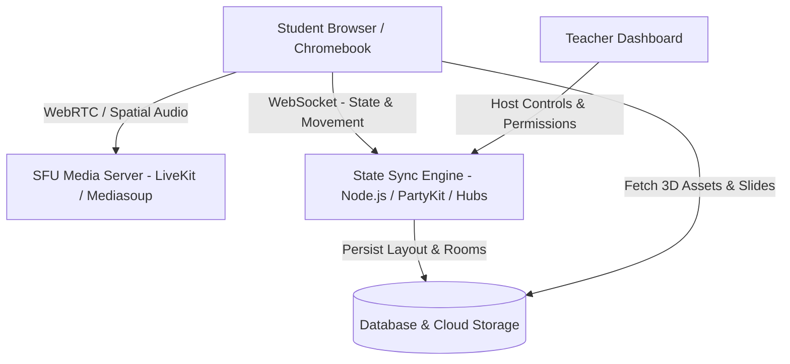
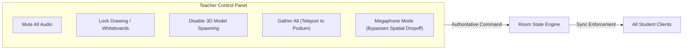

# 3D Virtual Classroom Platform: Master Architecture & Implementation Blueprint

> **Superseded by [BLUEPRINT.md](../BLUEPRINT.md) (v2).** Kept for the original product vision only. Its stack options, budgets, FPS targets and compliance section are out of date; see "Corrections to v1" in v2.

> **Project Goal:** Build a lightweight, browser-first 3D virtual classroom platform (open-source alternative to FrameVR) tailored for K-12, higher education, and tutoring. Runs with zero installation across Chromebooks, PCs, Macs, and VR headsets.

---

## 1. Executive Summary & Value Proposition

Traditional video conferencing (Zoom/Teams) induces fatigue, restricts collaborative movement, and makes group work rigid. This platform delivers:
- **Spatial Audio Collaboration:** Students walk up to breakout tables and talk in natural clusters without manual breakout room configuration.
- **Interactive 3D Curriculum:** Teachers drop 3D science models, historical artifacts, diagrams, and PDF presentations directly into the environment.
- **Zero Client Friction:** 100% browser-based via WebGL/WebXR. No `.exe` or app downloads required (strictly compatible with school-managed Chromebooks).
- **Privacy & Compliance First:** Self-hosted or private cloud architecture compliant with FERPA, COPPA, and GDPR.



---

## 2. Technical Stack Evaluation & Selection

Choose one of two baseline architectures depending on team skillset:

### Option A: The "Turnkey Educational Base" — Hubs Community Edition (CE)
* **Base Repo:** [`Hubs-Foundation/hubs`](https://github.com/Hubs-Foundation/hubs)
* **Frontend:** A-Frame / Three.js (WebXR)
* **Backend:** Node.js, Elixir / Janus / Dialog WebRTC
* **Scene Editor:** Spoke (built-in 3D drag-and-drop web editor)
* **Best For:** Fastest route to a classroom-ready platform. Already contains PDF rendering, whiteboard markers, screen sharing, and avatar movement.

### Option B: The "Modern Modular Base" — Hyperfy Core
* **Base Repo:** [`hyperfy-xyz/hyperfy`](https://github.com/hyperfy-xyz/hyperfy)
* **Frontend:** Three.js + WebGL + WebXR
* **Physics & Netcode:** PhysX + Node.js WebSockets
* **Avatars:** VRM standard + Ready Player Me
* **Best For:** Teams wanting clean, modern JavaScript/TypeScript code that AI models (Claude, Gemini) can easily refactor, extend, and restyle.

---

## 3. Strict Hardware & Performance Budgets (Chromebook Compliance)

> [!IMPORTANT]
> The #1 reason educational 3D apps fail is lag on student hardware. Strict asset limits must be enforced on upload.

| Metric | Target Budget | Hard Cap |
| :--- | :--- | :--- |
| **Total Room Geometry** | < 80,000 polygons | 150,000 polygons |
| **Total 3D File Size** | < 12 MB | 25 MB |
| **Texture Resolutions** | 1024x1024 (max 2048 for whiteboards) | No 4K textures |
| **Draw Calls** | < 80 draw calls | 120 draw calls |
| **Target Frame Rate** | 60 FPS | 30 FPS floor on Intel Celeron/UHD Graphics |
| **Lighting** | Fully baked lightmaps (ambient + directional light only) | Avoid real-time dynamic shadows |

---

## 4. Educational Features & Teacher "God Mode"



### 4.1 Teacher Moderation Tools (Critical)
1. **Megaphone / Broadcast Audio:** Allows the teacher’s voice to be heard across the entire 3D space at equal volume, overriding spatial audio falloff.
2. **Mute All / Force Mute:** Instant toggle to quiet the room.
3. **Lockdown Mode:**
   * Disable object spawning (prevents student spamming).
   * Lock drawing tools and whiteboards.
   * Restrict movement (locks student position to seats during lectures).
4. **"Gather All" (Instant Teleport):** Teleports all student avatars immediately to seats or to the front podium.

### 4.2 Classroom Collaboration Modules
* **Interactive Slide Projector:** Teachers upload PDF/PPT slides; advanceable via clicker buttons or keyboard arrows.
* **Breakout Pods:** Distinct physical zones with sound-dampening barriers so adjacent groups don't overhear each other.
* **Hand Raise Queue:** Students click a UI button; a visual indicator appears above their avatar and adds them to a priority queue on the teacher's HUD.
* **3D Inspection Pedestals:** Rotating pedestals where teachers place 3D models (e.g., cell organelles, motors, molecules) that students can inspect synchronously.

---

## 5. Security, Privacy, and Safety Checklist

- [ ] **Zero-PII Guest Mode:** Students join via simple room PIN or invite link with a display name only; no email or personal information required.
- [ ] **Protected Room Codes:** Rooms can be locked with a password or accessible only when the host teacher is present.
- [ ] **COPPA & FERPA Compliance:** No third-party behavioral trackers (e.g., Google Analytics, Meta Pixel) inside classroom instances.
- [ ] **Content Moderation:** Sanitize image and 3D model uploads; support one-click kick/ban for abusive participants.

---

## 6. Four-Phase Execution Roadmap

### Phase 1: Local Setup & Base Validation (Days 1–5)
- [ ] Select base repository (Hubs CE or Hyperfy).
- [ ] Set up local development environment (`localhost:3000`).
- [ ] Verify multi-client connection (open two browser windows: 1 Host, 1 Student).
- [ ] Test movement, spatial audio falloff, and basic avatar rendering.

### Phase 2: Classroom Environment & Optimization (Days 6–10)
- [ ] Source or model a low-poly modern classroom layout with a lecture zone and 4 breakout tables.
- [ ] Bake lighting textures in Blender to achieve high realism at zero GPU runtime cost.
- [ ] Export as optimized `.glb` using Draco texture compression.
- [ ] Verify 45+ FPS performance on a low-spec laptop.

### Phase 3: Teacher Control Overlay & Education Tools (Days 11–18)
- [ ] Implement Teacher HUD (Mute All, Gather All, Lock Tools).
- [ ] Integrate PDF/presentation screen component.
- [ ] Add spatial audio range attenuation (sound radius tuning for breakout tables).
- [ ] Build hand-raising queue mechanism.

### Phase 4: Cloud Deployment & Pilot Testing (Days 19–28)
- [ ] Deploy containerized application to cloud infrastructure (Hetzner, AWS, or DigitalOcean).
- [ ] Configure SSL, custom domain, and WebRTC STUN/TURN servers.
- [ ] Run a 15-minute mock lesson with 1 teacher and 5–8 test students.
- [ ] Record latency, audio clarity, and user interface friction points.

---

## 7. Ready-to-Use AI Assistant Prompts

Use the following modular prompts when asking an AI assistant to implement specific subsystems:

### Prompt A: Implementing the Teacher Moderation System
```text
Context: We are building an educational 3D virtual classroom on top of an open-source WebXR codebase.
Task: Create a host/teacher moderation module in TypeScript.
Requirements:
1. Define a 'HostPermissions' state interface with: isMutedAll, isSpawningLocked, isDrawingLocked, isMovementLocked.
2. Create an authoritative server event handler that validates whether the requestor has the 'TEACHER' role.
3. Implement a 'gatherAllStudents(targetPosition: [number, number, number])' method that emits a forced position update to all non-host clients.
4. Implement a 'toggleMegaphoneMode(enabled: boolean)' that overrides spatial audio attenuation falloff curves so the host's voice is heard at 1.0 volume room-wide.
```

### Prompt B: Optimizing 3D Classroom Assets for Chromebooks
```text
Context: We need to ensure our 3D classroom scene runs at 60 FPS on school Chromebooks.
Task: Provide a Three.js scene loader and configuration script.
Requirements:
1. Load a .glb classroom model using GLTFLoader with Draco compression support.
2. Traverse all meshes to automatically set castShadow = false and receiveShadow = false, relying on baked lightmaps.
3. Configure renderer settings: antialias: false (or pixelRatio capped at 1.5), powerPreference: "high-performance".
4. Add an FPS monitor that automatically lowers texture resolution or LOD if frame rates drop below 25 FPS for >3 seconds.
```

### Prompt C: Interactive Presentation Screen (PDF to 3D Canvas)
```text
Context: Inside our 3D virtual classroom, the teacher needs to present slides.
Task: Build a 3D Presentation Screen component.
Requirements:
1. Accept a PDF file upload or URL.
2. Render pages onto an offscreen HTML canvas using PDF.js.
3. Map the canvas as a Dynamic CanvasTexture onto a 16:9 Three.js PlaneGeometry in the 3D scene.
4. Synchronize page index changes across all connected clients via WebSocket room messages.
5. Provide Next Page, Previous Page, and Fullscreen buttons visible only to users with presenter permissions.
```
